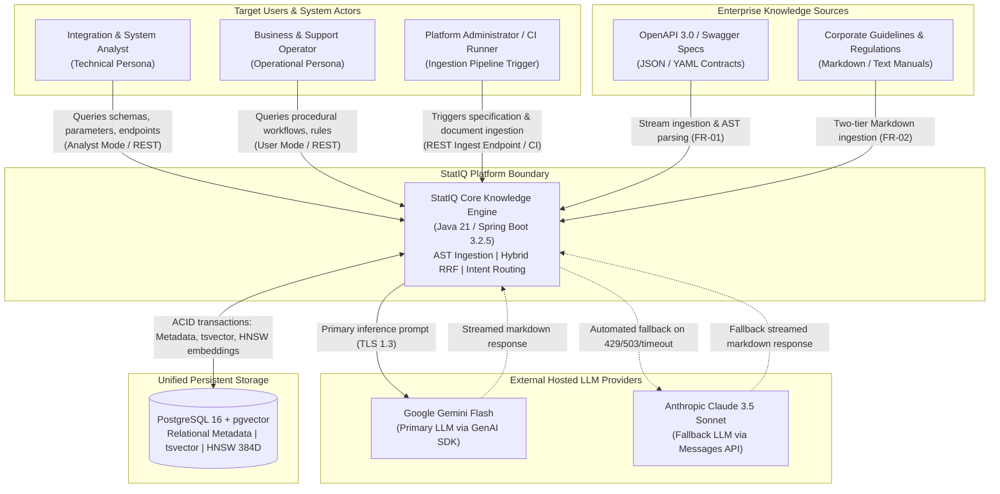
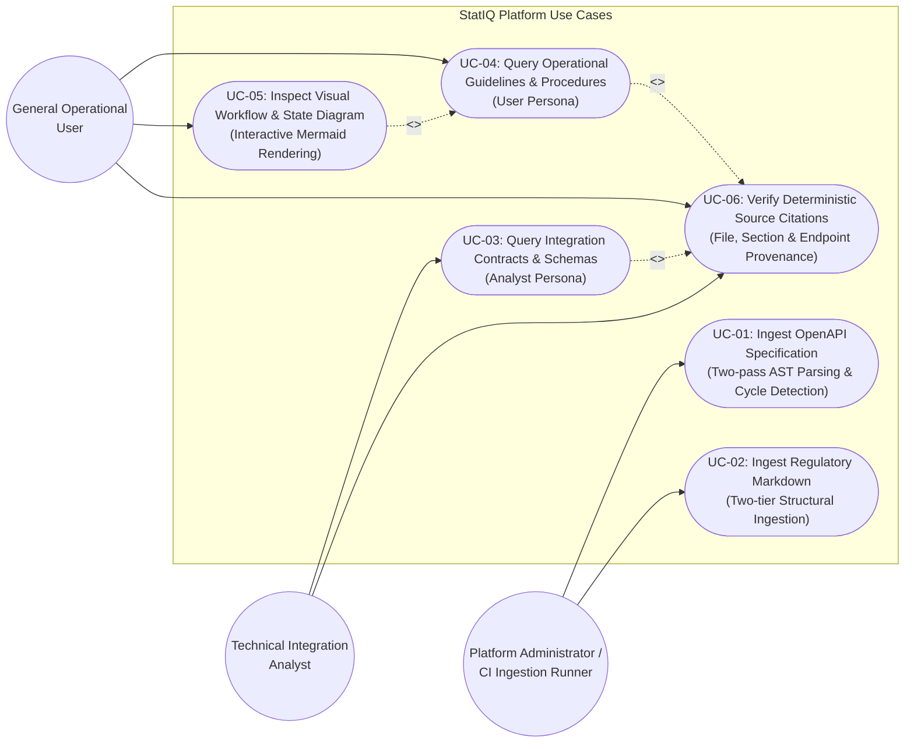
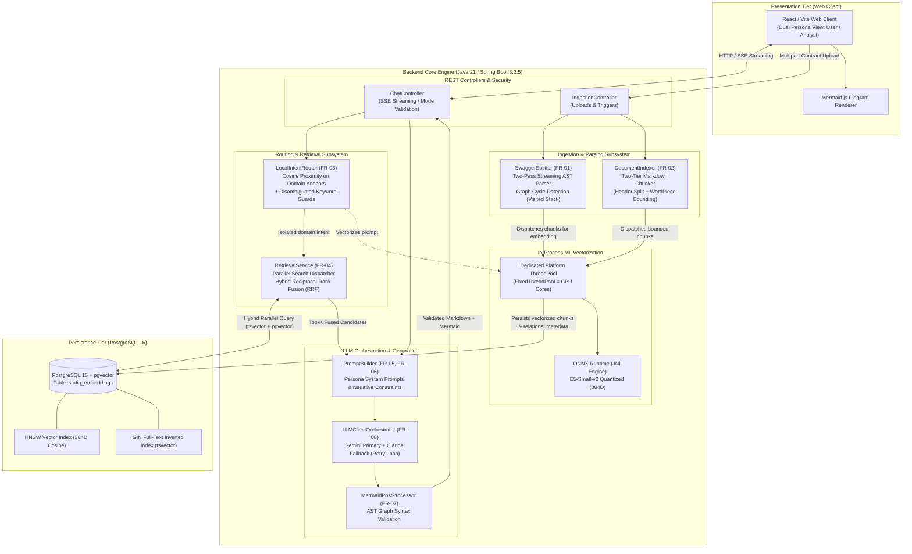

# Architectural Description and Structural Models: StatIQ Platform

## 1. Architectural Principles & System Context

The **StatIQ platform** is engineered as a high-throughput, modular monolithic Retrieval-Augmented Generation (RAG) system with localized semantic intent routing. It bridges the enterprise gap between unstructured/semi-structured regulatory guidelines (Markdown) and deeply nested machine-readable REST interfaces (OpenAPI 3.0 / Swagger specifications).

### Core Architectural Decisions:
1. **Unified Storage Model:** Relational document metadata, lexical inverted indexes (`tsvector`), and high-dimensional dense vector graphs (`pgvector` with HNSW) are consolidated within PostgreSQL 16 to guarantee ACID consistency and prevent dual-write drift (NFR-02).
2. **In-Process Vectorization:** High-speed vector embeddings are generated directly within the JVM using ONNX Runtime bindings (`langchain4j-embeddings-e5-small-v2-q`, 384 dimensions), isolating JNI calls inside a dedicated platform thread pool to eliminate Project Loom carrier thread pinning (NFR-03, NFR-04).
3. **Deterministic Pre-Retrieval Routing:** Incoming queries are pre-classified by `LocalIntentRouter` via in-memory cosine proximity against pre-computed domain anchor clusters combined with lexical keyword guards to eliminate cross-domain context noise (FR-03).
4. **Hybrid Rank Aggregation:** Sparse lexical matching and dense approximate nearest neighbor vectors are fused via Reciprocal Rank Fusion (RRF) with domain penalties to reliably resolve exact alphanumeric tokens (FR-04).

---

## 2. System Context Diagram (Level 1)

The System Context diagram establishes the boundaries of the StatIQ engine, defining external human actors, upstream document ingestion sources, external hosted generative APIs, and unified persistence.

---

## 3. Use Case Diagram (Functional Scenarios)

The Use Case diagram delineates the functional interaction boundaries for both operating personas (`User` vs. `Analyst`) and platform administration, mapping directly to business scenarios and requirements FR-01 through FR-07.

---

## 4. Component Diagram (Internal Architecture & Pipelines)

The Component Diagram details the internal modular structure of the Spring Boot 3.2.5 backend, illustrating how ingestion, vectorization, intent routing, hybrid search, persistence, and generative orchestration interact.

---

## 5. Architectural Alignment Matrix (Requirements ↔ Components ↔ Data ↔ Scenarios)

In accordance with the pre-defense evaluation rubric (*"Whether requirements, components, data, and scenarios are aligned"*), the table below establishes explicit bidirectional traceability across the system dimensions:

| Requirement (SRS) | Architectural Component | Underlying Data Entity / Index | Operational Use Case Scenario | Alignment Verification Method |
|---|---|---|---|---|
| **FR-01 (OpenAPI AST Ingestion)** | `SwaggerSplitter` | `statiq_embeddings` (Type: `SWAGGER_OPERATION`, JSONB metadata) | **UC-01 (Ingest OpenAPI Spec)** | Verifies complete operation segmentation and cyclic termination with `{"$ref_cycle": ...}`. |
| **FR-02 (Markdown Ingestion)** | `DocumentIndexer` | `statiq_embeddings` (Type: `DOCUMENTATION`, breadcrumb path) | **UC-02 (Ingest Regulatory Markdown)** | Verifies chunk token ceiling ($\le 450$ WordPiece) and metadata hierarchy preservation. |
| **FR-03 (Intent Classification)** | `LocalIntentRouter` | In-memory Anchor Vectors (`float[384]`), domain keyword sets | **UC-03, UC-04 (Pre-Retrieval Routing)** | Verifies $\ge 90\%$ classification accuracy across $N=200$ test suite without external LLMs. |
| **FR-04 (Hybrid RRF Retrieval)** | `RetrievalService` | PostgreSQL `tsvector` (GIN) + `pgvector` (HNSW cosine) | **UC-03, UC-04 (Hybrid Retrieval)** | Verifies $100\%$ Top-3 retrieval of unique error codes; Mean Reciprocal Rank $MRR \ge 0.85$. |
| **FR-05 (Grounded Response)** | `PromptBuilder` | Negative constraints prompt template, source tags | **UC-06 (Verify Source Citation)** | Verifies deterministic refusal marker `[INSUFFICIENT_CONTEXT]` on out-of-domain queries. |
| **FR-06 (Dual-Role Presentation)** | `ChatController`, `PromptBuilder` | Role parameter (`user` vs `analyst`), persona templates | **UC-03 (Analyst Query), UC-04 (User Query)** | Verifies strict suppression of raw JSON in User mode and presence of schemas in Analyst mode. |
| **FR-07 (Workflow Diagrams)** | `MermaidPostProcessor` | Extracted Mermaid syntax blocks (`graph TD`, `sequenceDiagram`) | **UC-05 (Inspect Visual Workflow)** | Verifies client-side SVG rendering of process graphs without syntax compiler crashes. |
| **FR-08 (LLM Fallback)** | `LLMClientOrchestrator` | Exponential backoff retry loop, SSE heartbeat comments | **UC-03, UC-04 (Failover Stream)** | Verifies failover to Claude upon simulated primary HTTP 429 without dropping the SSE connection. |
| **NFR-02 (ACID Co-location)** | PostgreSQL 16 + `pgvector` | Unified relational schema: metadata + vector columns | **UC-01, UC-02 (Atomic Persistence)** | Verifies $0\%$ data drift or orphan vectors after simulated database crash restarts. |
| **NFR-04 (Loom Carrier Isolation)**| `FixedThreadPool` | Dedicated OS platform thread queue for ONNX JNI calls | **UC-03, UC-04 (Vectorization Load)** | Confirms zero `jdk.VirtualThreadPinned` events via continuous JFR telemetry profiling. |

---

## 6. End-to-End Query Execution Flow ($V_{in} \to V_{out}$)

When an HTTP request is submitted to `POST /api/chat`, the execution traverses the following 8-stage pipeline:

```mermaid
flowchart LR
    Vin(["User Query (Vin)"]) --> S1["1. ChatController<br/>(Payload Validation)"]
    S1 --> S2["2. LocalIntentRouter<br/>(Vector Anchors + Guards)"]
    S2 --> S3["3. RetrievalService<br/>(Parallel tsvector + HNSW)"]
    S3 --> S4["4. RetrievalService<br/>(Reciprocal Rank Fusion)"]
    S4 --> S5["5. PromptBuilder<br/>(Context Injection & Citations)"]
    S5 --> S6["6. LLMClientOrchestrator<br/>(Gemini Flash / Claude Fallback)"]
    S6 --> S7["7. MermaidPostProcessor<br/>(AST Syntax Verification)"]
    S7 --> S8["8. ChatController<br/>(SSE Chunk Delivery)"]
    S8 --> Vout(["Client Stream (Vout)"])
```

1. **Ingestion & Validation:** `ChatController` receives payload `{ question, mode: "user" | "analyst", history }` over HTTP, validating input tokens.
2. **Intent Classification:** `LocalIntentRouter` evaluates query embeddings against pre-computed domain anchors in JVM memory, applying keyword guards to resolve target silos (`API_REQUEST`, `ROLES_AND_ACCESS`, `PROCESS_GUIDELINE`, or `METHODOLOGY_REGULATION`).
3. **Parallel Hybrid Query Dispatch:** `RetrievalService` executes parallel queries against PostgreSQL 16:
   * Lexical search via native inverted GIN index (`tsvector`).
   * Dense vector nearest-neighbor search via HNSW index (`pgvector`, cosine distance).
4. **Reciprocal Rank Fusion (RRF):** Candidate lists are aggregated using $RRF(d) = \sum \frac{1}{60 + r(d)}$. Swagger penalization heuristics suppress technical JSON schemas if the active intent is purely methodological.
5. **Prompt Assembly:** `PromptBuilder` formats retrieved passages, injecting role-dependent system instructions and deterministic source markers (`Source: [filename]`).
6. **Generative Inference & Fallback:** `LLMClientOrchestrator` streams prompt tokens to Google Gemini Flash. If rate limits (429/503) or timeouts occur, the retry loop activates Anthropic Claude fallback while transmitting SSE heartbeats.
7. **Post-Processing & Validation:** `MermaidPostProcessor` verifies graph syntax and strips formatting artifacts.
8. **Client Rendering:** The frontend application parses stream chunks in real-time, rendering syntax-highlighted code blocks, source citation chips, and interactive Mermaid SVG diagrams.

