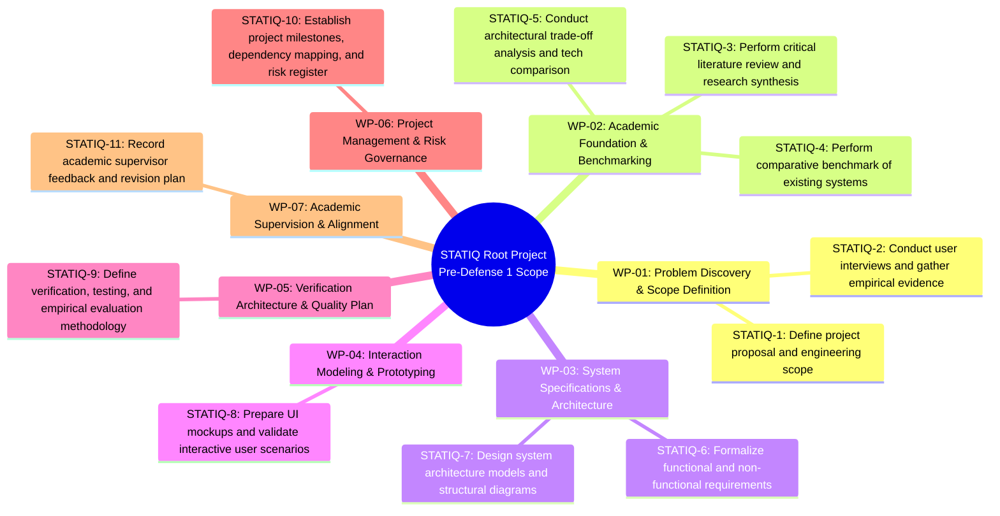
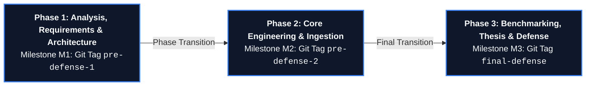
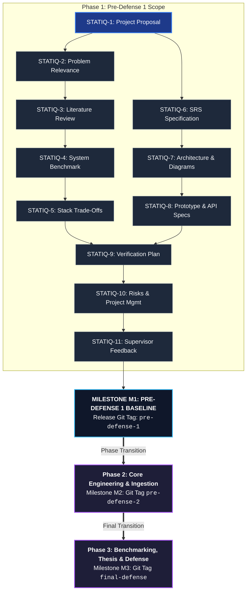

# Project Management, Milestone Roadmap, and Risk Governance: StatIQ Platform

## 1. Introduction & Governance Framework

The delivery of the **StatIQ platform** follows an empirical, trace-driven software engineering process. To satisfy the pre-defense evaluation rubric (*"A Git repository, a YouTrack project, allocation of responsibilities, project milestones, risks, and dependencies; whether project activities are traceable and the next steps are clearly defined"*), this document formalizes:
1. **Repository Topology & Version Control Governance:** Branching strategy, commit message specifications, Pull Request lifecycle, and release tagging rules.
2. **Issue Tracking Architecture (YouTrack Cloud):** Board mechanics, ticket lifecycle states, estimation, and bidirectional commit traceability.
3. **Resource & Responsibility Allocation:** RACI matrix mapping the solo software engineer's functional specializations alongside academic supervision.
4. **Milestone Schedule & Critical Path Dependencies:** Sequential phase roadmap showing how the 11 baseline components establish Pre-Defense 1, transitioning toward subsequent stages.
5. **Project Risk Register & Contingency Playbooks:** Multi-dimensional risk scoring with concrete architectural and operational mitigation strategies.

---

## 2. Version Control Governance (Git Baseline)

The project enforces structured Git workflows to ensure commit progression cannot be misrepresented through single-day code dumps (strict adherence to course regulations).

### 2.1. Branching Strategy (Feature-Branch Workflow)
* **`main`:** Production-grade, peer-reviewed baseline. Direct commits are restricted. All contributions must merge through Pull Requests.
* **`STATIQ-{ID}-{feature-name}`:** Dedicated task branches branched exclusively from updated `main` (e.g., `STATIQ-10-project-management`).
* **Release Tags:** Semantic release tags mark defense evaluation checkpoints per university guidelines:
  * `pre-defense-1` (Analysis, design, requirements, and architecture baseline).
  * `pre-defense-2` (Core implementation, integration tests, and initial benchmarks).
  * `final-defense` (Validated production system and empirical thesis evaluation).

### 2.2. Commit Message Standard
Every commit message must begin with the corresponding YouTrack task prefix:
```
STATIQ-{ID}: {Imperative Verb} {Clear Description of Incremental Deliverable}

Example:
STATIQ-10: Establish risk register, project milestones, and Git governance
```

### 2.3. Traceability Chain


Each Pull Request description must explicitly reference the originating YouTrack issue, detail the functional delta, and document verification evidence prior to merging.

---

## 3. Issue Tracker Configuration (YouTrack Cloud)

Project management operations are hosted on YouTrack Cloud under an accessible project space:
* **Tracker Instance:** Project STATIQ on YouTrack Cloud
* **Project ID:** `STATIQ`
* **Board Paradigm:** Agile Kanban Board (Continuous flow with Work-In-Progress constraints).

### 3.1. Issue Lifecycle States
| Workflow State | Entry Criteria | Exit Criteria |
|---|---|---|
| **Queue (Backlog)** | Task formulated with title, background, and Acceptance Criteria. | Developer assigns priority and pulls ticket to active development. |
| **Development (In Progress)** | Dedicated Git feature branch checked out locally. | Code/document complete, all unit tests passing locally. |
| **Review / Pull Request** | GitHub Pull Request opened with verification checklist. | Code review completed; PR merged into `main`. |
| **Testing / Verification** | Automated CI pipeline passes; acceptance criteria verified. | Empirical criteria or documentation structure validated. |
| **Done (Resolved)** | PR merged, branch deleted, verification evidence attached. | Issue closed; tracked in milestone progress. |

### 3.2. Work Breakdown Structure (WBS) & Task Mapping
The scope for the current Pre-Defense 1 baseline is decomposed into 11 foundational tasks mapped across 7 core Work Packages:



---

## 4. Resource Allocation & Responsibility Matrix (RACI)

While executed as an individual diploma project (Solo Developer), the engineering workflow distinguishes functional specializations to maintain clear operational boundaries with academic supervision.

* **AK:** Aldiyar Khassenov (Lead Software Engineer / Student Researcher)
* **IO:** Islam Omirzak (Academic Supervisor / Senior Lecturer / PhD Candidate)
* **EC:** Examination Committee (Astana IT University Evaluation Board)

| Project Activity / Deliverable | AK (Architecture & Core) | AK (QA & Integration) | IO (Supervisor) | EC (Committee) |
|---|---|---|---|---|
| Problem Statement & Proposal Formulation | **A / R** | C | C | I |
| Literature Review & Prior Art Synthesis | **A / R** | C | C | I |
| System Requirements Formalization (SRS) | **A / R** | R | C | I |
| Architecture & Structural Diagramming | **A / R** | C | C | I |
| OpenAPI AST Ingestion & Parser Implementation | **A / R** | R | I | I |
| Hybrid Sparse-Dense Search & Semantic Router | **A / R** | R | I | I |
| React Web Client & Diagram Visualization | **A / R** | R | I | I |
| Empirical Benchmarking (MRR, Recall@K, Latency) | R | **A / R** | C | I |
| Git Hygiene, Traceability & YouTrack Audits | **A / R** | R | C | I |
| Supervisor Academic Reviews & Revision Audits | R | R | **A** | I |
| Pre-Defense 1 Evaluation & Deliverables Review | I | I | C | **A** |
| Final Defense Evaluation & Grading | I | I | C | **A** |

*Legend: R = Responsible (executes task); A = Accountable (final decision/ownership); C = Consulted (provides feedback); I = Informed (notified of results).*

---

## 5. Project Milestones, Roadmap & Critical Path Dependencies

The project lifecycle is organized into three sequential academic checkpoints corresponding to official Git release tags.

### 5.1. Sequential Milestone Roadmap



* **Milestone M1: Pre-Defense 1 (Tag: `pre-defense-1`) — Requirements, Architecture & Planning Baseline**
  * *Deliverables:* Repository baseline, canonical proposal, literature review matrix, existing system benchmark, technology comparison, formal SRS (FR/NFR), system context / use case / component diagrams, prototype specification, verification plan, risk register, and supervisor feedback log (All 11 components: STATIQ-1 to STATIQ-11).
  * *Exit Gate:* Formal review by the examination committee; zero unlinked deliverables; verification of release tag `pre-defense-1`.
* **Milestone M2: Pre-Defense 2 (Tag: `pre-defense-2`) — Core Engine Implementation & Pipeline Integration**
  * *Deliverables:* Operational ingestion pipeline (`SwaggerSplitter` + `DocumentIndexer`), in-process ONNX vectorization runtime, PostgreSQL 16 + `pgvector` hybrid search engine, and React web client connected to backend REST endpoints.
  * *Exit Gate:* Automated integration test execution passing with 100% success; working end-to-end prototype demonstration.
* **Milestone M3: Final Defense (Tag: `final-defense`) — Empirical Benchmarking & Academic Thesis Submission**
  * *Deliverables:* Formal benchmark execution report (MRR, Recall@K, Latency across evaluation queries vs. Naive Dense RAG baseline), finalized diploma thesis document, user guide, and production containerized deployment configuration.
  * *Exit Gate:* Successful public defense and final thesis submission.

### 5.2. Critical Path & Dependency Network (Pre-Defense 1 Convergence)
All 11 initial engineering and analytical tasks are strictly structured to converge on the successful delivery and evaluation of **Pre-Defense 1**.



---

## 6. Project Risk Register & Contingency Management

Risks are categorized into Technical (TECH), Schedule (SCHED), Operational (OPS), and External (EXT). Each risk is assigned an empirical Probability score ($P \in [1..5]$) and Impact score ($I \in [1..5]$), yielding a Risk Exposure Index ($R = P \times I$).

| Risk ID | Risk Description | Category | Prob (P) | Imp (I) | Exposure ($R$) | Preemptive Mitigation Strategy | Contingency Recovery Playbook |
|---|---|---|---|---|---|---|---|
| **RSK-01** | **LLM API Rate Limiting & Service Outages:** Primary generative API returns HTTP 429 or becomes unreachable during demonstrations. | EXT | 3 | 5 | **15 (High)** | Architect multi-provider failover pipeline (`LLMClientOrchestrator`) with secondary LLM fallback and exponential retry loops. | Enable local mock model provider or pre-cached response fixture for critical test scenarios. |
| **RSK-02** | **Project Loom Carrier Thread Pinning:** JNI native calls in ONNX Runtime block virtual thread carrier pools, degrading query concurrency. | TECH | 3 | 4 | **12 (High)** | Isolate ONNX embedding inference in a dedicated `FixedThreadPool` bounded by physical CPU cores; profile via JFR `jdk.VirtualThreadPinned`. | Offload vectorization to a local lightweight sidecar process communicating over domain sockets if JNI pinning persists. |
| **RSK-03** | **OpenAPI Schema Fragmentation & Memory Bloat:** Large OpenAPI specifications with deep recursion cause heap exhaustion during batch parsing. | TECH | 2 | 4 | **8 (Medium)** | Implement stream parsing via Jackson and enforce cyclic graph traversal detection (`visited_refs` stack) with a recursion ceiling of 10. | Fall back to endpoint-only metadata chunking, deferring complex payload resolution to demand-driven retrieval. |
| **RSK-04** | **Scope Creep & Implementation Overextension:** Attempting full real-time agentic write-back execution, jeopardizing defense timeline. | SCHED | 3 | 3 | **9 (Medium)** | Strictly enforce MoSCoW priorities: write-back and deep OCR are formally classified as *Won't Have* in the project SRS. | Cut secondary frontend polish; focus exclusively on verifiable backend retrieval metrics (MRR, Recall@K). |
| **RSK-05** | **Testbed Discrepancy & Evaluation Flakiness:** Benchmark metrics fluctuate due to unmetered background CPU loads during performance testing. | OPS | 2 | 4 | **8 (Medium)** | Enforce standardized Reference Benchmark Environment (4 dedicated vCPUs, fixed RAM, NVMe) with unmetered warm-up phases. | Discard outlier test runs with p99 latency spikes exceeding 3 standard deviations; re-run automated benchmark suites. |
| **RSK-06** | **Supervisor Feedback Misalignment:** Major architectural objections raised late in the development cycle requiring structural refactoring. | SCHED | 2 | 4 | **8 (Medium)** | Maintain regular supervisory review cadences (`docs/supervisor_feedback.md`), logging formal decisions and prompt adaptations early. | Prioritize supervisor-mandated adjustments as blocker issues on the YouTrack board ahead of planned feature development. |

---

## 7. Next Steps & Phase 2 Transition Plan

Upon completion of Milestone M1 (Pre-Defense 1) and tagging `pre-defense-1`, the project transitions immediately into Phase 2 execution:

1. **Iteration 1 Execution:**
   * Finalize `SwaggerSplitter` unit test coverage verifying atomic operation extraction.
   * Configure Docker Compose multi-container environment (PostgreSQL 16 + pgvector container initialization scripts).
   * Verify automated database migrations using Flyway.
2. **Iteration 2 Execution:**
   * Integrate in-process ONNX vectorization runtime with `FixedThreadPool` isolation.
   * Implement `LocalIntentRouter` with domain anchor clusters and keyword guards.
   * Construct `RetrievalService` multi-stage ranking pipeline (pgvector HNSW lookup + heuristic domain bonuses).
3. **Continuous Tracking Protocol:**
   * Maintain linear task progression in YouTrack: no code without a ticket; no merge without review evidence.
   * Tag `pre-defense-2` upon completion of Phase 2 deliverables for the second committee review.

